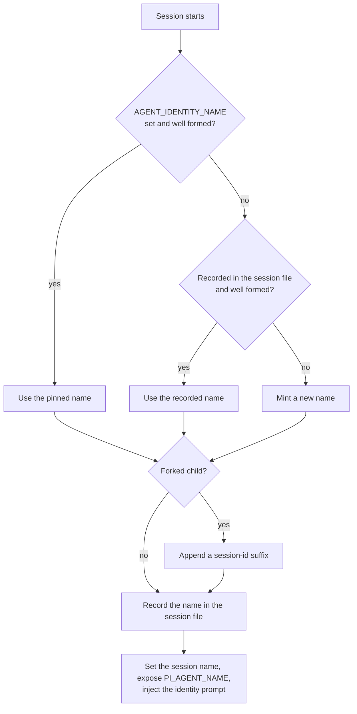

# pi-agent-name

Standalone agent names for pi sessions: a persistent, human-readable identity
such as `swift-koala-42`, with **no daemon, no socket, and no intercom
dependency**.

## What a name does

The extension gives every pi session one name and puts it to work:

| Surface | Effect |
|---|---|
| Session name | The session is named after the agent, so a window is identifiable at a glance |
| Footer | The name sits in the footer as well, so a hand-typed rename cannot bury it |
| System prompt | Identity rules are injected, so the agent signs its work consistently |
| `PI_AGENT_NAME` | Every shell command the agent runs can read its own name |
| Git commits | The identity rules instruct the agent to add a `Co-authored-by` trailer to each commit |
| `/whoami` | Prints the current name |
| `session_rename` tool | Renames the session to `<agent-name>: <task>` without losing the name prefix |

## The footer stays when the session name does not

A session name is mutable. `/name` replaces it wholesale, and so does any tool
that renames a session, so the `<agent-name>: ` prefix that `session_rename`
composes can disappear at any moment. The footer widget is the copy that
cannot: its text is derived from the identity the session was minted with,
never from the name the session currently displays.

The widget is registered through [pi-footer-widget](https://github.com/elecnix/pi-footer-widget),
a bridge over pi-statusbar, pi-powerline-footer, and the stock footer, so the
name lands wherever the user's footer keeps extension statuses. On the stock
footer it reads as one extension status line:

```text
theme-picker (feat/theme-picker) • swift-koala-42
12.4%/1.0M (auto)                          (ollama) glm-5.3:cloud • high
agent swift-koala-42
```

A `/name` that drops the session prefix only changes the first line.

The widget adds a line to the footer; it never replaces one. That holds on
every composer the bridge covers, and it holds when the bridge is not there:
rather than draw a footer of its own, the extension writes nothing at all, so
nothing already displayed is displaced. A missing dependency costs the agent
name in the footer, and nothing else.

A bridge that fails to load or throws while registering is treated as missing.
A footer widget is a nicety; it must never be the reason a session fails to
start.

## Install

```bash
pi install git:github.com/elecnix/pi-agent-name
```

## How it works

A name is minted locally and stored in the session file, which is the only
source of truth. There is no registry to consult and no process to keep alive.



1. **An explicit pin wins.** `AGENT_IDENTITY_NAME`, when it is set and well
   formed, overrides whatever the session file remembers. This is the pin used
   by tests, scripts, and session revival; a pin that is not well formed is
   ignored rather than trusted.
2. **Then the recorded name.** A reload or a resumed conversation keeps the
   identity it already had.
3. **Mint last.** Only a session with neither a pin nor a record draws a name
   from the vocabulary.
4. **Fork disambiguation.** A forked subtask copies its parent's entries,
   including the name. When the child inherited that name — through the pin or
   the session file — it is re-identified with a deterministic suffix derived
   from its own session id, so parent and child never run as one name. A
   freshly minted name inherits nothing, so it is left alone.

## Collision risk

Uniqueness rests on the size of the name space, not on a registry. A name is an
adjective, an animal, and a number from 0 to 99:

| Pool | Count |
|---|---|
| Adjectives | 229 |
| Animals | 229 |
| Suffixes | 100 |
| **Names** | **5,244,100** |

A fresh draw therefore matches one particular existing name with probability
`1 / 5,244,100`, which is **1.9 × 10⁻⁷** — about one in five million, well
below the one-in-a-million target. Against a fleet of `n` live agents the chance
of sharing *some* name is `n × 1.9 × 10⁻⁷`: still under one in ten thousand for
fifty concurrent sessions.

Collisions are reduced, never eliminated. Two sessions started in the same
instant can independently draw the same name, and nothing detects it
afterwards. That is the deliberate trade for having no registry.

## Standalone by construction

The extension imports nothing beyond the Node standard library, the pi
extension API, and one optional footer bridge. It opens no socket, starts no
child process, and writes no files outside the session. Stopping pi stops
everything the extension does.

That bridge, `pi-footer-widget`, is optional at run time: it carries the name
into the footer, and the extension keeps working without it.

## Using it alongside pi-agent-identity

Both extensions can be installed. They record the name under a shared
`agent-identity-name` session entry as well as their own, so a session that was
named by one is adopted by the other instead of minting a second identity. They
also both write the same `<agent_identity>` prompt tag, so the identity block is
never injected twice.

The larger extension adds intercom addressing, offline revival, and mention
tracking on top of the same name. Install this one when a name is all you want.

## Configuration

| Variable | Direction | Effect |
|---|---|---|
| `AGENT_IDENTITY_NAME` | read at session start | Pins the name. When set and well formed it overrides the recorded name; otherwise the session keeps the name it had. |
| `PI_AGENT_NAME` | written for shell commands | The resolved name, exported to every `bash` tool call. It is output only: a nested pi session that inherits it does not adopt it, because two live sessions must not share one name. |

## Requirements

`pi-footer-widget` is a runtime dependency, installed by pi with the extension.
Without it the extension still starts and still names the session; only the
footer line is absent, and nothing else in the footer changes.

## Development

The test suite uses the Node test runner and type stripping, with no
dependencies to install:

```bash
npm test
```

## License

No license file is included yet.
